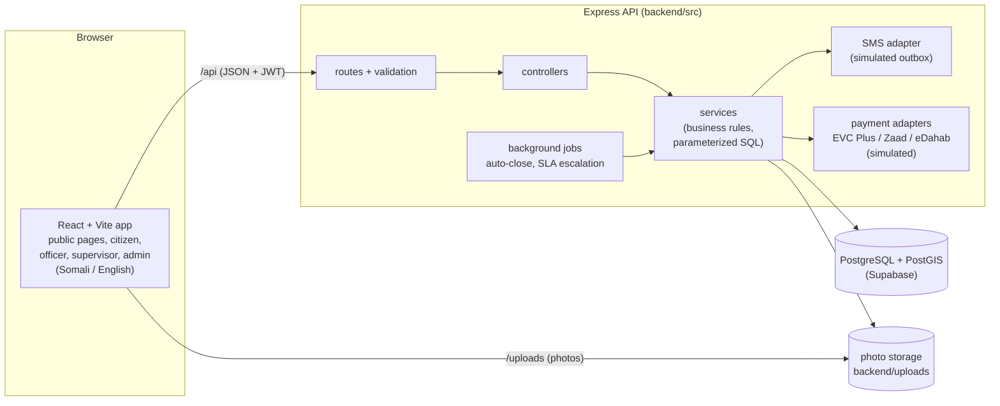
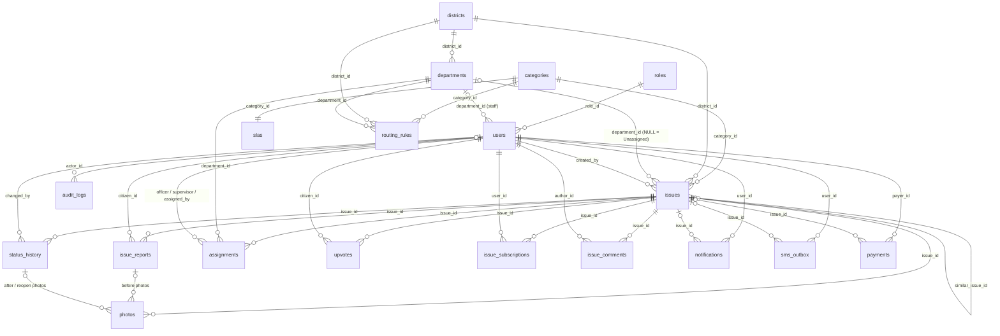
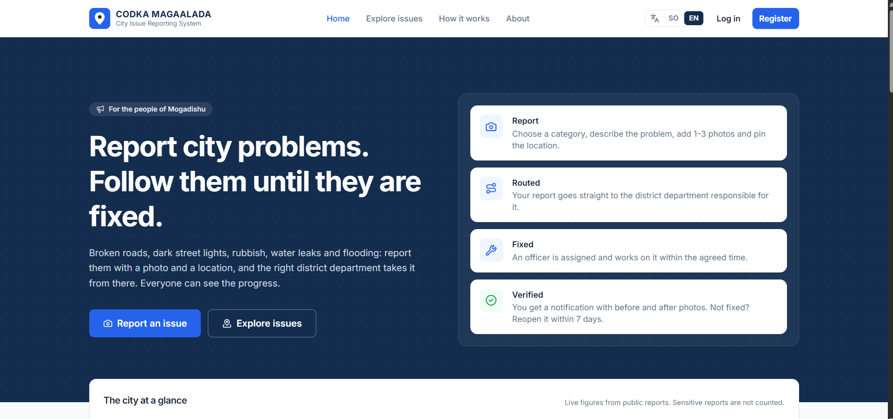
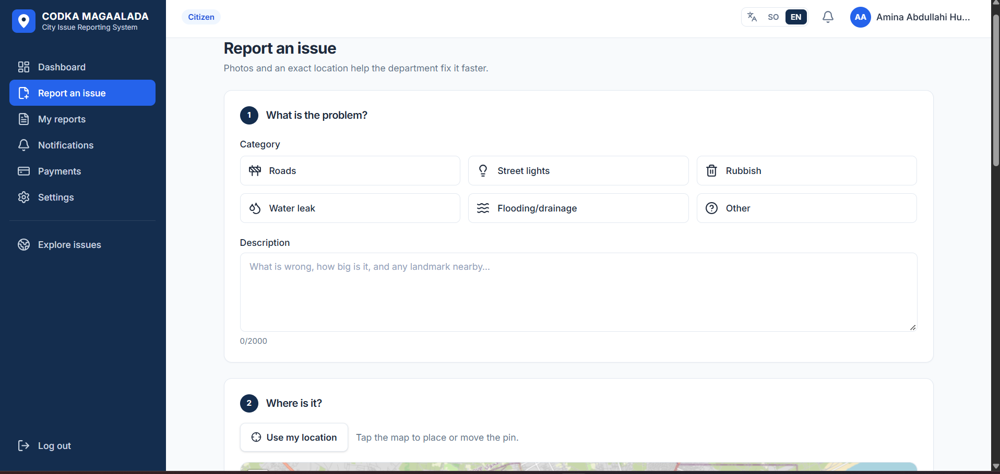
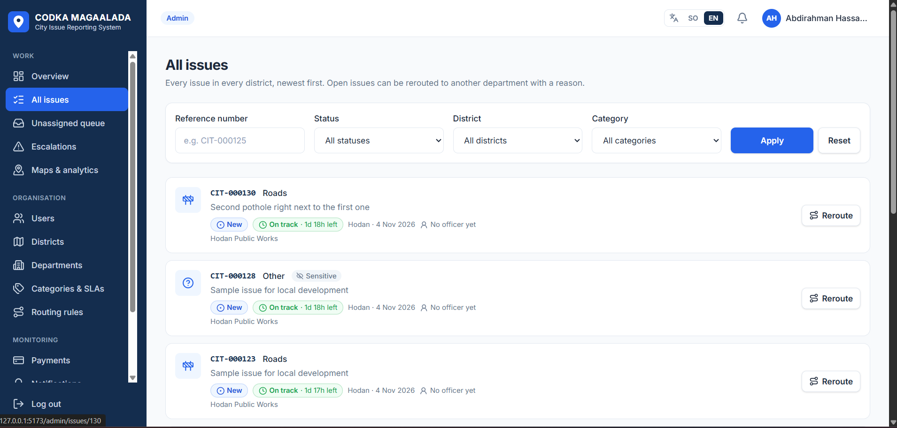
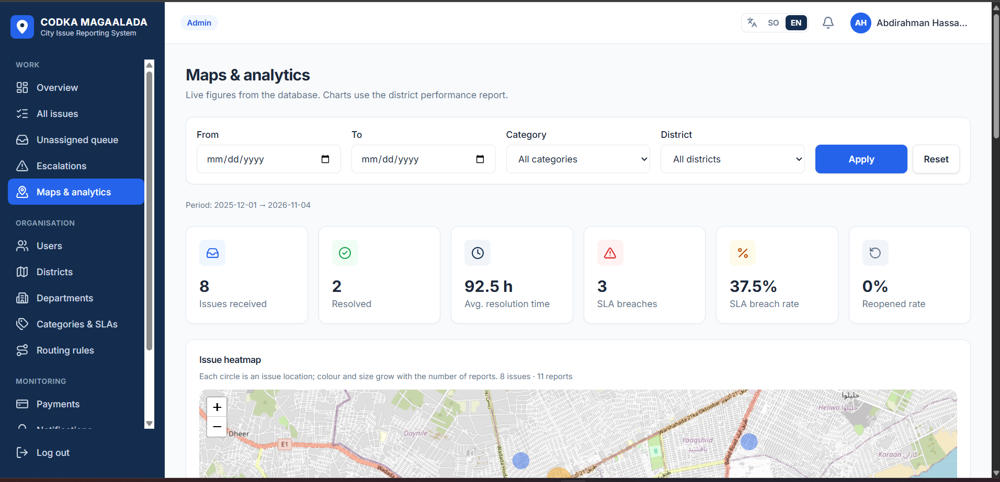
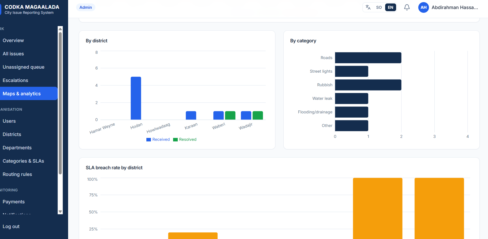

# City Issue Reporting System

Somalia 10X — Project 13. A web system where residents report city problems
(broken roads, street lights, rubbish, water leaks, flooding) and district
departments assign, fix and track them. Full requirements:
[PROJECT_REQUIREMENTS.md](PROJECT_REQUIREMENTS.md).

## Project status

| Area | Status |
|---|---|
| Database schema (19 tables, PostGIS) — `backend/database/schema.sql` | Done |
| Seed data (districts, departments, routing, SLAs, demo users) — `backend/database/seed.sql` | Done |
| Backend foundation: config, DB pool, security middleware, error handling | Done |
| Authentication: phone + password login, JWT, `/me` | Done |
| Citizen registration (phone + password, role fixed to citizen) | Done |
| Server-side role authorization (citizen / officer / supervisor / admin) | Done (every protected route; see [Roles and permissions](#roles-and-permissions)) |
| Audit log of sensitive actions (who, what, when): logins, registrations, user/district/department/category changes, routing rules, SLAs, reroutes, assignments, sensitive flag, escalations, payments | Done |
| Feature 1 — Report an issue: category, description, 1–3 photos, GPS location, district detection (or chosen district), `CIT-000123` reference, "Outside service area" | Done (backend API) |
| Feature 2 — Duplicate detection and merging: same category, 50 m, 7 days; "Add my report to this issue"; "This is different" with the 10 m supervisor-review flag | Done (backend API) |
| Feature 3 — Automatic department routing: routing rules, automatic assignment, Admin Unassigned queue, manual reroute with a reason | Done (backend API). Karaan intentionally has no routing — see [Known limitations](#known-limitations) |
| Feature 4 — Status workflow: `New → Assigned → In progress → Resolved → Closed`, status history (who, when, comment), resolve with after photos, citizen reopen within 7 days, 2nd reopen to the supervisor, automatic closure after 7 days | Done (backend API). New → Assigned is made by officer assignment (Feature 7) |
| Feature 5 — SLA timers: Admin configures resolution hours per category; clock starts at creation; remaining time; orange at 75%, red when breached; "Waiting for materials" still counts | Done (backend API) |
| Feature 7 — Officer assignment and workload: supervisors see their department's issues, assign or reassign officers of their department (not on leave), see each officer's open workload; officers see only their own issues | Done (backend API) |
| Feature 9 — Citizen notifications: every status change creates an in-app notification and a simulated SMS for every linked citizen (original and merged reports), in Somali and English, with the reference number and new status; SMS can be turned off, in-app cannot | Done (backend API) |
| Feature 6 — Escalation: every SLA breach is marked permanently; supervisors of the issue's department are notified in-app (Somali and English); a supervisor comment or officer (re)assignment counts as their action; admins are alerted if nobody acted within 24 hours of the deadline, or at once if there is no supervisor; supervisor and admin escalation lists; staff comments | Done (backend API) |
| Feature 8 — Before and after photos: citizen photos are before photos; resolving needs 1–3 after photos taken within 50 m of the issue (officer's GPS); before/after photos per viewer; side by side on the public page | Done (backend API) |
| Feature 10 — Public issue status: no login; category, district, status, report count, report date and map location; filters by district, category and status; sensitive issues hidden; admin marks issues sensitive | Done (backend API) |
| Feature 11 — Upvotes: citizens select "Me too" on any open, non-sensitive issue; one upvote per citizen per issue; resolved/closed issues cannot be upvoted; public list sortable by upvote count | Done (backend API) |
| Feature 12 — Live heatmap: real issue locations weighted by report count, read live from the database; filters by category and date range (and district); public (no sensitive issues), supervisors (own district) and admin (all); empty-map message | Done (backend API) |
| Feature 13 — District performance report: per district received, resolved, average resolution time, SLA breaches and %, reopened rate, monthly chart; date range and category filters; zero values for districts without issues; admin (all districts) and supervisors (own district) | Done (backend API) |
| Simulated mobile money payments (brief §6.6): EVC Plus, Zaad and eDahab behind provider adapters; start, confirm with a simulated PIN, cancel; receipt with a unique number; no real gateway or money | Done (backend API) |
| Admin management (brief §3.4): staff accounts, roles, activation, officer leave; districts (GeoJSON boundaries); departments; category names and activation | Done (backend API) |
| Citizen "My reports", fix rating; supervisor duplicate-review queue; staff issue details | Done (backend API) |
| Simulated SMS outbox behind a replaceable SMS adapter (`src/sms/providers.js`) | Done |
| GitHub Actions CI (`.github/workflows/backend-ci.yml`: `npm ci` + `npm test`, Node 20 and 22) | Configured (first run happens on GitHub after a push) |
| Staff workflow notifications (officers, supervisors, admins), staff assignment history, Admin "All issues" page with search and reroute | Done (frontend + backend API) |
| Frontend (React + Vite): public pages, citizen workspace, officer / supervisor / admin workspaces, maps and analytics, simulated payments, Somali and English — see [frontend/README.md](frontend/README.md) and [frontend/REQUIREMENTS_COVERAGE.md](frontend/REQUIREMENTS_COVERAGE.md) | Done (tested in the browser against the backend app on its test database; live Supabase run pending) |

## Technology stack

| Layer | Technology |
|---|---|
| Runtime | Node.js 20+ (developed on 22.17) |
| API | Express 5.3 |
| Database | Supabase PostgreSQL 15+ with PostGIS, `pg` 8.23 |
| Auth | `jsonwebtoken` 9 (HS256), `bcrypt` 6 |
| Security | `helmet` 8, `cors` 2.8, `express-rate-limit` 8, `express-validator` 7 |
| Uploads | `multer` 2.5 (memory storage); photos stored on local disk |
| Config | `dotenv` 18 |
| Tests | Jest 30, Supertest 7 |
| Frontend | React 19.3, React Router 7.18, Vite 8.3, Tailwind CSS 4.3, Axios 1.21 |
| Maps and charts | Leaflet 1.9 + React Leaflet 5.0 (maps, heatmap), Recharts 3.10 (analytics) |
| Icons | lucide-react 1.70 |
| Languages | Somali and English (frontend dictionaries in `frontend/src/i18n`; API messages in both languages) |

## Architecture



- The browser only talks to the API (`/api`) and the photo folder (`/uploads`).
- Every request: `route → validation → controller → service → database`.
  Roles are checked on the server for every protected route.
- SMS and payments go through adapters, so real providers can replace the
  simulators later.
- Local development (`npm run dev`) uses the same Express app on an
  in-memory database instead of PostgreSQL (see
  [Local development](#local-development-one-command)).

## Backend architecture

```
backend/
├── database/            schema.sql, seed.sql (run in Supabase SQL editor);
│                        backfill_auto_route_assignments.sql (dry run by default, not applied)
├── src/
│   ├── server.js        entry point: checks env, starts server, clean shutdown
│   ├── app.js           Express app: helmet → cors → JSON → rate limit → routes → errors
│   ├── config/          env.js (validated settings), db.js (pg connection pool)
│   ├── routes/          URL → middleware + validation → controller
│   ├── controllers/     HTTP in/out only
│   ├── services/        business logic and parameterized SQL (data access)
│   ├── middleware/      auth (authenticate/authorize), validate, upload, rate limiters, errors
│   ├── storage/         photoStorage.js — the only code that reads/writes photo files
│   ├── jobs/            autoClose.job.js, escalation.job.js — background jobs, started by server.js only
│   ├── payments/        providers.js — EVC Plus / Zaad / eDahab adapters (simulators)
│   ├── sms/             providers.js — SMS adapter (simulated in-app outbox)
│   └── utils/           AppError, JWT, password, phone and image-type helpers
├── uploads/             uploaded photos (created on first upload, git-ignored)
└── tests/               Jest + Supertest (database replaced by an in-memory fake)
```

Request flow: `route → validation → controller → service → database`.

Security notes:
- Every SQL statement uses `$1, $2…` parameters; no user input is concatenated into SQL.
- The JWT only identifies the user. On every request the user and role are
  re-read from the database, so a role change or disabled account takes
  effect immediately.
- Login returns the same error for an unknown phone and a wrong password, and
  takes the same time for both, so registered numbers cannot be discovered.
- Errors never expose stack traces or SQL to the client.

## Local development: one command

Requirements: Node.js 20 or newer. No database is needed.

```bash
npm install --prefix backend
npm install --prefix frontend
npm run dev          # from the project root
```

This starts both parts in one terminal, with `[backend]` and `[frontend]` log
prefixes. Open <http://127.0.0.1:5173>. Press **Ctrl+C** to stop both.

- The backend runs on `127.0.0.1:5000` with an **in-memory database** and
  sample data (`backend/scripts/dev-memory-server.js`). It never reads
  `backend/.env`, never loads the PostgreSQL client, never connects to
  Supabase and never starts the production background jobs. Data is lost
  when it stops.
- It runs without watch mode, so it only restarts when you stop and start
  it. Its clock is the real time (dates match the calendar; resolution and
  SLA times are real), and the SLA escalation pass runs on the in-memory data
  at start-up and then every 60 seconds (supervisor notifications, and the
  Admin alert 24 hours after a deadline with no supervisor action).
- The frontend (Vite) runs on `127.0.0.1:5173` and proxies `/api` and
  `/uploads` to that backend, only after checking it answers as in-memory.
- It refuses to start if port 5000 or 5173 is already in use, if
  `NODE_ENV=production`, or if `VITE_API_ORIGIN` is set. If either process
  stops, the other is stopped too.
- Demo logins (password `CityDemo#2026`): admin `+252610000001`, supervisor
  `+252610000101`, officer `+252610000201`, citizen `+252610000301`.

Other root scripts: `npm run dev:check` (runs the safety checks only, starts
nothing), `npm test` (backend tests), `npm run build` (frontend build).
`npm run dev` inside `backend/` or `frontend/` still works on its own.

## Setup on a fresh computer (real database)

Requirements: Node.js 20 or newer, and a Supabase project.

### 1. Database (once)

In the Supabase dashboard → **SQL Editor**, run in this order:
1. `backend/database/schema.sql`
2. `backend/database/seed.sql`

### 2. Backend

```bash
cd backend
npm install
cp .env.example .env      # Windows PowerShell: Copy-Item .env.example .env
```

Edit `backend/.env` and set at least `DATABASE_URL` and `JWT_SECRET`, then:

```bash
npm start       # the real server: uses backend/.env and the database, starts the background jobs
npm run dev     # in-memory development server instead (ignores .env, see above)
npm test        # run all tests (no database needed)
```

Check `npm start` works: open <http://localhost:5000/api/health> — it should
show `"database": "up"`.

### 3. Frontend

```bash
cd frontend
npm install
npm run dev     # http://localhost:5173 (proxies /api and /uploads to the backend)
npm run build   # production build in frontend/dist
```

## Environment variables

Defined in `backend/.env` (template: [backend/.env.example](backend/.env.example)).
Never commit `.env`; it is listed in `.gitignore`.

| Variable | Required | Default | Purpose |
|---|---|---|---|
| `DATABASE_URL` | yes | — | Supabase connection string (Settings → Database → URI). Do not add `?sslmode=`. |
| `JWT_SECRET` | yes | — | Secret for signing tokens, at least 32 characters. |
| `JWT_EXPIRES_IN` | no | `8h` | Token lifetime (e.g. `30m`, `8h`, `1d`). |
| `PORT` | no | `5000` | API port. |
| `NODE_ENV` | no | `development` | `development`, `production` or `test`. |
| `DB_SSL` | no | `true` | Use SSL to the database. `false` only for a local PostgreSQL. |
| `DB_SSL_CA_PATH` | no | — | Path to the Supabase CA certificate to fully verify the server. |
| `DB_POOL_MAX` | no | `10` | Maximum database connections. |
| `CORS_ORIGIN` | no | `http://localhost:5173` | Allowed frontend origin(s), comma-separated. |
| `RATE_LIMIT_WINDOW_MS` | no | `900000` | Rate-limit window (15 minutes). |
| `RATE_LIMIT_MAX` | no | `300` | Requests per IP per window for all `/api` routes. |
| `LOGIN_RATE_LIMIT_MAX` | no | `10` | Failed login attempts per IP per window. |
| `REGISTER_RATE_LIMIT_MAX` | no | `5` | Registration attempts (all, successful or not) per IP per window. |
| `REPORT_RATE_LIMIT_MAX` | no | `20` | Issue report submissions (`POST /api/issues`) per IP per window. |
| `DUPLICATE_CHECK_RATE_LIMIT_MAX` | no | `60` | Duplicate checks (`GET /api/issues/duplicates`) per IP per window. |
| `WORKFLOW_RATE_LIMIT_MAX` | no | `60` | Status changes, resolves and reopens (`PATCH /status`, `POST /resolve`, `POST /reopen`) per IP per window. |
| `AUTO_CLOSE_INTERVAL_MS` | no | `900000` | How often the auto-close job runs (15 minutes). It also runs once at start-up. |
| `ESCALATION_INTERVAL_MS` | no | `300000` | How often the SLA escalation job runs (5 minutes). It also runs once at start-up. |
| `AFTER_PHOTO_MAX_DISTANCE_METRES` | no | `50` | After photos must be taken within this distance of the issue location (Feature 8). |
| `UPLOADS_DIR` | no | `backend/uploads` | Folder where uploaded photos are stored. Relative paths are relative to `backend/`. A drive root (`C:\`, `/`) is rejected at startup. |

Generate a JWT secret:

```bash
node -e "console.log(require('crypto').randomBytes(48).toString('hex'))"
```

## Database overview

`backend/database/schema.sql` (PostgreSQL + PostGIS) creates the 12 tables the
brief requires plus 7 supporting tables. Every table has a primary key;
relationships use foreign keys (`ON DELETE RESTRICT` unless noted), and
business rules are also enforced by CHECK / UNIQUE constraints and indexes.

| Table | Purpose | Main relationships |
|---|---|---|
| `roles` | the 4 roles (citizen, officer, supervisor, admin) | — |
| `users` | accounts (phone login, bcrypt hash, language, SMS setting, leave, active) | `role_id → roles`, `department_id → departments` (staff) |
| `districts` | service districts with a PostGIS boundary (district detection) | — |
| `departments` | district departments | `district_id → districts` |
| `categories` | the 6 issue categories (English + Somali names) | — |
| `slas` | resolution hours per category | `category_id → categories` (one each) |
| `routing_rules` | category + district → department | `category_id`, `district_id`, `department_id` (same district) |
| `issues` | one row per real-world problem (`CIT-000123`, status, location, SLA deadline, escalation and review flags, sensitive flag) | `category_id`, `district_id`, `department_id` (NULL = Admin Unassigned queue), `similar_issue_id → issues` |
| `issue_reports` | every citizen report linked to an issue (original + merged), fix rating | `issue_id → issues`, `citizen_id → users`; one per citizen per issue |
| `photos` | before / after / reopen photos (file path, type, size, where taken) | `issue_id`, `issue_report_id` (before), `status_history_id` (after, reopen) |
| `status_history` | every status change (who, from, to, comment, time) | `issue_id`, `changed_by → users` |
| `assignments` | department / officer / supervisor assignments; one current per issue | `issue_id`, `department_id`, `officer_id`, `supervisor_id`, `assigned_by` |
| `upvotes` | "Me too" votes | primary key (`issue_id`, `citizen_id`) |
| `issue_subscriptions` | citizens following an issue | `issue_id`, `user_id` |
| `issue_comments` | staff comments | `issue_id`, `author_id → users` |
| `notifications` | in-app notifications (English + Somali text) | `user_id`, `issue_id` |
| `sms_outbox` | simulated SMS | `user_id`, `issue_id` |
| `payments` | simulated mobile-money payments (`PAY-` / `RCP-` generated) | `payer_id → users`, `issue_id` (optional) |
| `audit_logs` | who did what, when (JSON details, IP) | `actor_id → users` (`SET NULL`) |



The trigger `issues_require_after_photo` refuses changing an issue to
`resolved` without an after photo. Row-level security is enabled on every table with no
policies, so only the backend (database owner) can read or write them.

## Roles and permissions

Checked on the server for every request (`authenticate` re-reads the user and
role from the database; `authorize` checks the role; services check
ownership, department and visibility).

| Role | Can |
|---|---|
| Citizen | register and log in by phone; report issues with photos and location; see their reports (`/api/issues/mine`) and status; upvote open issues; reopen within 7 days; rate the fix; notifications and own SMS outbox; simulated payments |
| Officer | issues assigned to them only; details and photos; move to In progress, waiting for materials; resolve with after photos at the location; comments; in-app notifications when an issue is assigned, reassigned away, rerouted away or reopened back to them |
| Supervisor | their department's issues and officers' workload; assign/reassign officers; duplicate-review queue; SLA escalations and comments; heatmap and performance report of their district; in-app notifications for new, flagged, rerouted and repeatedly reopened issues of their department |
| Admin | users and roles, districts, departments, categories, routing rules, SLAs; All issues list (search, filters) and Unassigned queue, reroute with a reason; mark issues sensitive; escalations, heatmap and reports for all districts; payments (read-only); in-app notifications for issues without a department and SLA escalation alerts |
| Public (no login) | public issue list and detail (no personal data, no sensitive issues), heatmap |

## API endpoints

Base URL: `http://localhost:5000/api`. All errors use one shape:

```json
{ "error": { "code": "VALIDATION_ERROR", "message": "Invalid request data", "details": [{ "field": "phoneNumber", "message": "..." }] } }
```

### `GET /api/health` — public

Checks the API and the database connection.

- `200` `{ "status": "ok", "database": "up", "timestamp": "2026-11-04T10:00:00.000Z" }`
- `503` `{ "status": "degraded", "database": "down", "timestamp": "..." }`

### `POST /api/auth/register` — public, rate-limited

Creates a **citizen** account and logs it in. The role is always set to
`citizen` on the server; officer, supervisor and admin accounts cannot be
created here.

Request:

```json
{ "fullName": "Hodan Abdi Farah", "phoneNumber": "+252615550001", "password": "SafePass123", "preferredLanguage": "so" }
```

| Field | Rules |
|---|---|
| `fullName` | required, 2–100 characters, must contain letters (trimmed) |
| `phoneNumber` | required, international format. Spaces, dashes, dots and brackets are removed and a `00` prefix becomes `+` (e.g. `00252 61-555 0001` → `+252615550001`). Local numbers like `0615550001` are rejected. |
| `password` | required, 8+ characters, at least one letter and one number, at most 72 bytes |
| `preferredLanguage` | optional, `so` (default) or `en` |

Any other field (for example `role`, `roleId`, `departmentId`) is rejected
with `400`, so a client cannot choose its own role.

Response `201`: same shape as login — `{ "token", "tokenType": "Bearer", "user": { ..., "role": "citizen", "department": null, "district": null } }`.

Errors: `400 VALIDATION_ERROR`, `409 PHONE_ALREADY_REGISTERED`,
`429 TOO_MANY_REQUESTS`.

### `POST /api/auth/login` — public, rate-limited

Request:

```json
{ "phoneNumber": "+252610000001", "password": "CityDemo#2026" }
```

`phoneNumber` must be in international format; spaces and dashes are removed.

Response `200`:

```json
{
  "token": "eyJhbGciOiJIUzI1NiIs...",
  "tokenType": "Bearer",
  "user": {
    "id": 2,
    "fullName": "Fadumo Ali Warsame",
    "phoneNumber": "+252610000101",
    "role": "supervisor",
    "preferredLanguage": "so",
    "smsNotificationsEnabled": true,
    "isOnLeave": false,
    "department": { "id": 1, "name": "Hodan Public Works" },
    "district": { "id": 1, "name": "Hodan" }
  }
}
```

`department` and `district` are `null` for citizens and admins.

Errors: `400 VALIDATION_ERROR` / `INVALID_JSON`, `401 INVALID_CREDENTIALS`,
`403 ACCOUNT_DISABLED`, `429 TOO_MANY_REQUESTS`.

### `GET /api/auth/me` — any logged-in user

Header: `Authorization: Bearer <token>`

- `200` `{ "user": { ...same shape as login... } }`
- `401` `AUTH_REQUIRED` (no token), `INVALID_TOKEN`, `TOKEN_EXPIRED`

### `GET /api/categories` and `GET /api/districts` — public

Reference data for the report form. Only active rows are returned.

- `GET /api/categories` → `200` `{ "categories": [{ "id": 1, "code": "roads", "nameEn": "Roads", "nameSo": "Waddooyin" }, ...] }` (ordered by id)
- `GET /api/districts` → `200` `{ "districts": [{ "id": 1, "name": "Hodan", "city": "Mogadishu" }, ...] }` (ordered by city, then name)

### Common rules for the issue and admin endpoints

- Header `Authorization: Bearer <token>`. Without a valid token: `401`
  (`AUTH_REQUIRED`, `INVALID_TOKEN`, `TOKEN_EXPIRED`). Wrong role: `403 FORBIDDEN`.
  The role is checked before any input is read or validated.
- Every field must be sent once; unknown fields or query parameters are
  rejected with `400 VALIDATION_ERROR` (`details` lists each field).
- IDs are positive whole numbers (no decimals, signs or exponents).
- `503 TRY_AGAIN` means a database row stayed locked for more than 5 seconds;
  nothing was saved and the request can be repeated.
- Unexpected errors return `500 INTERNAL_ERROR` without internal details.

### `POST /api/issues` — citizen only, rate-limited (Features 1 and 2)

Reports an issue, or adds the report to an existing issue. Body:
`multipart/form-data`.

| Field | Rules |
|---|---|
| `categoryId` | required, id of an active category |
| `description` | required, 10–2000 characters after trimming |
| `latitude` / `longitude` | required, plain decimal numbers, −90…90 / −180…180 |
| `districtId` | optional. Used only when the point is inside no district boundary and the chosen district has no boundary loaded. Empty = not chosen |
| `photos` | 1–3 files, JPEG, PNG or WebP (checked from the file bytes), max 5 MB each |
| `duplicateOfIssueId` | optional — "Add my report to this issue". Empty = not chosen |
| `confirmDifferent` | optional, exactly `true` — "This is different" |

Send at most one of `duplicateOfIssueId` and `confirmDifferent`.

What the server does:
1. Detects the district from the point. A point outside every district is
   rejected with `422 OUTSIDE_SERVICE_AREA` and the message `Outside service area`.
2. **No decision sent:** if open, non-sensitive issues of the same category
   exist within 50 m (created in the last 7 days), it answers
   `409 POSSIBLE_DUPLICATES` and saves nothing. `error.details.candidates`
   has the same shape as `GET /api/issues/duplicates`. Otherwise a new issue
   is created. The check is repeated inside the database transaction.
3. **`confirmDifferent=true`:** the duplicate check is skipped and a new issue
   is created.
   For every new issue: if an open issue of the same category, created in
   the last 7 days, is within 10 m (sensitive issues included), the new issue
   is flagged for supervisor review. The flag is never returned to the citizen.
4. **`duplicateOfIssueId`:** the selected issue is locked and re-checked
   (same category, open, not sensitive, last 7 days, within 50 m). The report
   is linked to it, its report count goes up by 1 and the citizen is
   subscribed. The issue's status does not change.
5. **New issues are routed** (Feature 3): the department comes from the
   routing rule for (category, district). With a department, the issue also
   gets its first assignment (`auto_route`, no officer yet). Without a rule
   (or with an inactive department) `department` is `null` and the issue
   goes to the Admin Unassigned queue. Merges never add an assignment.

All rows of one report are written in one transaction; if anything fails,
nothing is saved and the uploaded photos are deleted.

Response `201`, new issue:

```json
{
  "outcome": "created",
  "issue": {
    "id": 123, "referenceNumber": "CIT-000123", "status": "new", "reportCount": 1,
    "description": "Large pothole near Hodan market",
    "category": { "id": 1, "code": "roads", "nameEn": "Roads", "nameSo": "Waddooyin" },
    "district": { "id": 1, "name": "Hodan", "city": "Mogadishu" },
    "department": { "id": 1, "name": "Hodan Public Works" },
    "location": { "latitude": 2.05, "longitude": 45.3 },
    "slaDueAt": "2026-11-18T08:00:00.000Z", "createdAt": "2026-11-04T08:00:00.000Z",
    "photos": [{ "id": 1, "url": "/uploads/issues/<uuid>.jpg" }],
    "sla": { "state": "on_track", "color": "green", "startedAt": "2026-11-04T08:00:00.000Z",
             "dueAt": "2026-11-18T08:00:00.000Z", "warningAt": "2026-11-14T20:00:00.000Z",
             "remainingSeconds": 1209600, "overdueSeconds": 0, "elapsedPercent": 0,
             "clockStopped": false, "evaluatedAt": "2026-11-04T08:00:00.000Z" }
  }
}
```

`sla` is the shared SLA timer (see [SLA timers](#sla-timers-feature-5));
`slaDueAt` is kept and always equals `sla.dueAt`.

Response `201`, merged into an existing issue (the existing issue's
description, location and reporters are not returned):

```json
{
  "outcome": "merged",
  "issue": { "id": 123, "referenceNumber": "CIT-000123", "status": "new", "reportCount": 2,
             "category": { ... }, "district": { ... }, "createdAt": "..." },
  "report": { "id": 456, "description": "...", "location": { "latitude": 2.05, "longitude": 45.3 },
              "createdAt": "...", "photos": [{ "id": 7, "url": "/uploads/issues/<uuid>.jpg" }] }
}
```

Errors:
- `400`: `VALIDATION_ERROR`, `INVALID_CATEGORY`, `INVALID_DISTRICT`,
  `PHOTOS_REQUIRED`, `TOO_MANY_PHOTOS`, `UNEXPECTED_FILE_FIELD`, `INVALID_UPLOAD`.
- `409`: `POSSIBLE_DUPLICATES`; `DUPLICATE_NOT_ELIGIBLE` for a selected issue
  that is unknown, closed, sensitive, too old, too far or of another category
  (one answer for all, so hidden issues are not revealed); `ALREADY_REPORTED`
  when this citizen already reported that issue.
- `413 PHOTO_TOO_LARGE`, `415 UNSUPPORTED_IMAGE_TYPE`.
- `422`: `OUTSIDE_SERVICE_AREA`, `CATEGORY_UNAVAILABLE` (the category has no SLA).
- `429 TOO_MANY_REQUESTS`, `503 TRY_AGAIN`, plus `401` / `403`.

### `GET /api/issues/duplicates?categoryId=&latitude=&longitude=` — citizen only, rate-limited

Lists possible duplicates before submitting: open issues (`new`, `assigned`,
`in_progress`) of the same category, within 50 m (inclusive), created in the
last 7 days. Sensitive issues are never listed. Nearest first, at most 10.
Read-only. All three query parameters are required (same rules as above).

Response `200` (the list may be empty):

```json
{
  "candidates": [{
    "id": 123, "referenceNumber": "CIT-000123", "status": "new", "reportCount": 2,
    "createdAt": "...", "distanceMetres": 18,
    "category": { "id": 1, "code": "roads", "nameEn": "Roads", "nameSo": "Waddooyin" },
    "photos": [{ "id": 1, "url": "/uploads/issues/<uuid>.jpg" }],
    "alreadyReportedByYou": false
  }]
}
```

`photos` are the before photos of the issue's original report. No reporter
details, descriptions or storage paths are returned.

Errors: `400 VALIDATION_ERROR`, `401`, `403`, `429 TOO_MANY_REQUESTS`.

### Status workflow (Feature 4)

`New → Assigned → In progress → Resolved → Closed`. Only these forward steps
exist; anything else (skipping, going back, changing to the same status)
returns `409 INVALID_TRANSITION` with
`details: { currentStatus, requestedStatus }`.

| Step | Made by | How |
|---|---|---|
| New → Assigned | a supervisor of the department assigning an officer | `POST /api/issues/:id/assign` (Feature 7) |
| Assigned → In progress | the assigned officer, or a supervisor of the issue's department | `PATCH /api/issues/:id/status` |
| In progress → Resolved | **only the officer currently assigned** | `POST /api/issues/:id/resolve` with 1–3 after photos |
| Resolved → Closed | the system, 7 days after resolution | automatic job |
| Resolved → reopened | a citizen linked to the issue, within 7 days | `POST /api/issues/:id/reopen` with 1–3 photos |

Admins never change a status (they reroute, which keeps the status).

Every change writes one `status_history` row in the same transaction: who
(`changed_by`, `NULL` for the system), previous and new status, the comment
and the database time. Each action locks the issue row first and checks the
status and permissions under that lock, so two changes at the same time
cannot both succeed (the second gets `409`). `503 TRY_AGAIN` if the row stays
locked for more than 5 seconds.

**Who can see an issue's workflow** (anyone else gets `404 ISSUE_NOT_FOUND`,
the same answer as for an unknown issue):
- a citizen who reported it, or whose report was merged into it (also for
  sensitive issues — it is their own report);
- the officer of its current assignment;
- a supervisor of its department, or the supervisor it was sent to on a reopen;
- an admin.

Comments (`comment`) are required everywhere: 5–1000 characters after
trimming. Unknown fields are rejected with `400`.

#### `GET /api/issues/:id/status` — logged-in users who can see the issue

```json
{
  "issue": {
    "id": 123, "referenceNumber": "CIT-000123", "status": "resolved", "subStatus": null,
    "reopenCount": 0,
    "resolvedAt": "2026-11-02T08:00:00.000Z", "reopenDeadline": "2026-11-09T08:00:00.000Z",
    "closedAt": null,
    "sla": { "state": "met", "color": "green", "dueAt": "...", "...": "see SLA timers" },
    "canReopen": true
  },
  "history": [
    { "id": 1, "fromStatus": null, "toStatus": "new", "fromSubStatus": null, "toSubStatus": null,
      "comment": "Issue reported by citizen",
      "isReopen": false, "changedBy": { "role": "citizen", "isYou": true }, "createdAt": "..." },
    { "id": 9, "fromStatus": "in_progress", "toStatus": "resolved", "fromSubStatus": null, "toSubStatus": null,
      "comment": "Pothole filled",
      "isReopen": false, "changedBy": { "role": "officer" }, "createdAt": "..." }
  ]
}
```

- `subStatus` is `"waiting_for_materials"` or `null` (only while in progress);
  history entries show sub-status changes in `fromSubStatus` / `toSubStatus`.
- `sla`: the issue's SLA timer for **everyone** who can see the issue,
  citizens included — see [SLA timers](#sla-timers-feature-5).
- `reopenDeadline` is set only while the status is `resolved`.
- Citizens get `canReopen`. Staff (officer, supervisor, admin) instead get
  `department` (`{ id, name }` or `null`) and `currentAssignment`
  (`{ type, officer: { id, name } | null, supervisor: { id, name } | null }` or `null`).
- Admins also get `escalation`: the issue's latest reopen escalation, or
  `null` if it was never escalated —
  `{ "reason": "reopened_twice" | "no_assigned_officer", "route": "supervisor" | "admin_unassigned", "reopenCount": 2, "previousDepartment": { "id": 2, "name": "Hodan Sanitation" } | null, "escalatedAt": "..." }`.
  It tells the admin why an issue arrived in the Unassigned queue (it comes
  from the `issue.reopen_escalation` audit entry). Other roles never get it,
  and the Unassigned queue response itself is unchanged.
- Staff also get a top-level `assignmentEvents` list (oldest first): every
  assignment row of the issue — automatic routing, officer assignment,
  reassignment (with its reason), admin reroute (with its reason) and reopen
  escalation. Reassigning and rerouting do not change the status, so they
  have no `history` entry; the staff issue page shows both lists in one
  timeline. Citizens never get it (it names staff).
  `{ "id": 7, "type": "auto_route" | "officer_assign" | "reassign" | "manual_reroute" | "reopen_escalation", "reason": "..." | null, "createdAt": "...", "department": { id, name } | null, "officer": { id, name } | null, "supervisor": { id, name } | null, "assignedBy": { id, name, role } | null }`
  (`assignedBy: null` = automatic).
- History is oldest first. `changedBy` is `null` for system changes. Citizens
  are never named (`{ "role": "citizen" }`). Staff are named only to staff
  (`{ id, role, name }`); citizens see only their role. A citizen does not
  see another citizen's comment (`comment: null`) — only staff, system and
  their own comments.

Errors: `400 VALIDATION_ERROR`, `401`, `404 ISSUE_NOT_FOUND`.

#### `PATCH /api/issues/:id/status` — officer or supervisor, rate-limited

Body (JSON), exactly one of:
- `{ "status": "in_progress", "comment": "Crew on site" }` — a status change.
  `status` must be one of `new`, `assigned`, `in_progress`, `resolved`,
  `closed`; the only change made here is **Assigned → In progress**.
- `{ "subStatus": "waiting_for_materials", "comment": "Waiting for asphalt" }`
  or `{ "subStatus": null, "comment": "Materials arrived" }` — set or clear
  **Waiting for materials** (Feature 5). Only while the issue is **In
  progress**, by the same people (the assigned officer or a supervisor of the
  department). It is recorded in the status history (the status stays
  `in_progress`), resolving clears it, and the **SLA clock keeps running**:
  the deadline never moves or pauses.

Response `200`:

```json
{
  "issue": { "id": 123, "referenceNumber": "CIT-000123", "status": "in_progress", "subStatus": null,
             "reopenCount": 0, "resolvedAt": null, "reopenDeadline": null, "closedAt": null },
  "historyEntry": { "id": 10, "fromStatus": "assigned", "toStatus": "in_progress",
                    "fromSubStatus": null, "toSubStatus": null, "comment": "Crew on site",
                    "isReopen": false, "changedBy": { "id": 6, "role": "officer", "name": "Ahmed Mahad Abdi" },
                    "createdAt": "..." }
}
```

Errors: `400 VALIDATION_ERROR` (also when both or neither of `status` /
`subStatus` are sent, or `subStatus` is not `waiting_for_materials` / `null`),
`401`, `403` (citizens, admins),
`404 ISSUE_NOT_FOUND`, `409 INVALID_TRANSITION` (the message says how the step
is made when it is not done here, e.g. "Use POST /api/issues/:id/resolve with
after photos to resolve an issue"), `409 OFFICER_REQUIRED` (no officer on the
current assignment, e.g. after a reroute), `409 SUB_STATUS_NOT_ALLOWED` (not in
progress), `409 SUB_STATUS_UNCHANGED` (already set / already clear), `429`,
`503 TRY_AGAIN`.

#### `POST /api/issues/:id/resolve` — the assigned officer, rate-limited

`multipart/form-data`: `comment`, `latitude` and `longitude` (where the
photos were taken: the officer's device GPS, Feature 8) and 1–3 after photos
in the `photos` field (JPEG, PNG or WebP, max 5 MB each). The issue must be
**In progress**. The point must be within `AFTER_PHOTO_MAX_DISTANCE_METRES`
(default 50 m, inclusive) of the issue, otherwise
`422 AFTER_PHOTO_NOT_AT_LOCATION` (`details: { distanceMetres, maxDistanceMetres }`);
it is stored in `photos.taken_location`.

The photos are saved first; then, in one transaction, the history row, the
`after` photo rows (linked to it) and the status update are written. The
photo rows are written before the update, so the database trigger that
requires an after photo is always satisfied — and still blocks any path
without one. `resolved_at` is set to the database time and any sub-status is
cleared. If anything fails, nothing is saved and the photo files are deleted.

Response `200`: `{ "issue": { ..., "status": "resolved", "resolvedAt": "...", "reopenDeadline": "..." }, "historyEntry": { ... }, "photos": [{ "id": 31, "url": "/uploads/issues/<uuid>.jpg" }] }`.

Errors: `400` (`VALIDATION_ERROR`, `PHOTOS_REQUIRED`, `TOO_MANY_PHOTOS`,
`UNEXPECTED_FILE_FIELD`, `INVALID_UPLOAD`), `401`, `403` (citizens, admins),
`403 NOT_ASSIGNED_OFFICER` (a supervisor of the department who is not the
assigned officer), `404 ISSUE_NOT_FOUND` (e.g. another officer),
`409 INVALID_TRANSITION`, `413 PHOTO_TOO_LARGE`, `415 UNSUPPORTED_IMAGE_TYPE`,
`429`, `503 TRY_AGAIN`.

#### `POST /api/issues/:id/reopen` — a linked citizen, rate-limited

`multipart/form-data`: `comment` (why it is not fixed) and 1–3 photos in the
`photos` field. Allowed only for a citizen who reported the issue or whose
report was merged into it, only while the issue is **Resolved**, and only
before `resolvedAt + 7 days` (database time; exactly 7 days is too late).

The reopen is recorded in `status_history` with `isReopen: true`, the photos
are stored as `reopen` photos linked to it, `reopenCount` goes up by 1 and
`resolvedAt` is cleared. Where the issue goes:
- **1st reopen:** back to **Assigned**, with the same officer assignment.
- **2nd and later reopens:** to the department supervisor. The current
  assignment is ended and a `reopen_escalation` assignment is created for the
  department's active supervisor (lowest id), with no officer; the status
  becomes **New**, so the supervisor assigns an officer again (Feature 7).
  The department itself must be active: a supervisor of an inactive
  department is never used.
- **No active supervisor, an inactive department, or no department at all:**
  the issue goes to the **Admin
  Unassigned queue** instead — status **New**, department cleared, no
  current assignment — so it is never left in a queue nobody watches. The
  admin reroutes it from there (Feature 3).
- A 1st reopen whose current assignment has no officer is handled like a
  2nd reopen.

Every escalation writes an `issue.reopen_escalation` audit entry (in the same
transaction) with `reopenCount`, `reason` (`reopened_twice` or
`no_assigned_officer`), `route` (`supervisor` or `admin_unassigned`), the
department, the supervisor (or `null`) and the ended assignment, so the admin
can see why an issue arrived. The response never names the supervisor.

Response `200`: `{ "issue": { ..., "status": "assigned" | "new", "reopenCount": 1, "resolvedAt": null }, "historyEntry": { ... }, "photos": [{ "id": 40, "url": "..." }] }`.

Errors: `400` (as resolve), `401`, `403` (officers, supervisors, admins),
`404 ISSUE_NOT_FOUND` (unknown issue or a citizen not linked to it),
`409 ISSUE_NOT_RESOLVED`, `409 REOPEN_WINDOW_EXPIRED`, `413`, `415`, `429`,
`503 TRY_AGAIN`.

#### Automatic closure

`src/jobs/autoClose.job.js`, started by `src/server.js` (never by `app.js`,
so tests do not start it). It runs once at start-up and then every
`AUTO_CLOSE_INTERVAL_MS` (default 15 minutes). Each run closes, in batches of
100 (one transaction each, at most 50 batches per run; any rest is closed on
the next run), the issues still **Resolved** with
`resolved_at <= now() - 7 days` (database time), oldest first: status
**Closed**, `closed_at` = database time, and a `status_history` row with
`changed_by = NULL` and the comment
`Closed automatically: not reopened within 7 days of resolution`.

- Rows are selected `FOR NO KEY UPDATE SKIP LOCKED`, so a reopen in progress
  is skipped, a row reopened meanwhile no longer matches, and several server
  instances never close the same issue twice. Running it again changes nothing.
- A reopen at the same moment is decided by the locked row and database time:
  a reopen is allowed while `now() < resolved_at + 7 days`, the job closes when
  `now() >= resolved_at + 7 days`, so exactly one of them can succeed.
- Each issue is closed inside its own `SAVEPOINT`. If one issue fails, only
  its own writes are undone, it is logged and skipped for the rest of that
  run, and the other issues still close; it is retried on the next run. So
  one bad row can never block the others.
- A failure of a whole batch (e.g. the database is unreachable) rolls that
  batch back, is logged and is retried on the next run; it never stops the
  server. Runs never overlap, and a logger that throws is ignored.

### Admin endpoints — admin only (Feature 3)

Every `/api/admin` route requires a logged-in **admin**; citizens, officers
and supervisors get `403`. Request bodies are JSON. In bodies, ids may be a
JSON number or digit text.

#### `GET /api/admin/routing-rules`

Every active category × active district, with its department, so missing
combinations are visible. No query parameters.

```json
{
  "rules": [{
    "category": { "id": 1, "code": "roads", "nameEn": "Roads", "nameSo": "Waddooyin" },
    "district": { "id": 1, "name": "Hodan", "city": "Mogadishu" },
    "department": { "id": 1, "name": "Hodan Public Works", "isActive": true },
    "routed": true
  }],
  "summary": { "total": 36, "routed": 30, "missing": 6 }
}
```

`department` is `null` when no rule exists. `routed` is `false` when there is
no rule or its department is inactive (such issues go to the Unassigned
queue). Ordered by city, district name, category id.

#### `PUT /api/admin/routing-rules/:categoryId/:districtId`

Creates or replaces the rule for one combination. Body: `{ "departmentId": 2 }`.
The department must be active and belong to **the same district**. Rules
cannot be deleted. A change affects new issues only.

- `201` `{ "outcome": "created", "rule": { ...same shape as above... } }`
- `200` `{ "outcome": "updated" | "unchanged", "rule": { ... } }`

Each create or update is written to the audit log (`routing_rule.create` /
`routing_rule.update`, with the old and new department) in the same
transaction; `unchanged` writes nothing.

Errors: `400 VALIDATION_ERROR` / `INVALID_DEPARTMENT` (unknown or inactive),
`404 CATEGORY_NOT_FOUND` / `DISTRICT_NOT_FOUND` (unknown or inactive),
`422 DEPARTMENT_NOT_IN_DISTRICT`, `503 TRY_AGAIN`.

#### `GET /api/admin/departments?districtId=`

All departments (active and inactive) with their district; `districtId` is
optional and filters to one district (an unknown district gives an empty list).

```json
{ "departments": [{ "id": 1, "name": "Hodan Public Works", "isActive": true,
                    "district": { "id": 1, "name": "Hodan", "city": "Mogadishu" } }] }
```

Errors: `400 VALIDATION_ERROR`.

#### `GET /api/admin/issues?status=&districtId=&categoryId=&departmentId=&search=&limit=&offset=`

The Admin "All issues" list: every issue, sensitive ones included, newest
first. Read-only; rerouting still uses `POST /api/admin/issues/:id/reroute`
with all of its checks.

- `status`: `all` (default), `open` (New, Assigned, In progress), `new`,
  `assigned`, `in_progress`, `resolved`, `closed`.
- `districtId`, `categoryId`, `departmentId`: optional filters.
- `search`: reference number or part of it (`CIT-000125`, `cit-000125`,
  `125`); up to 30 characters, only letters, digits and `-` are used.
- `limit` 1–100 (default 20), `offset` (default 0).

```json
{
  "issues": [{
    "id": 125, "referenceNumber": "CIT-000125", "status": "in_progress", "subStatus": null,
    "description": "...", "reportCount": 2, "isSensitive": false,
    "category": { "id": 3, "code": "rubbish", "nameEn": "Rubbish", "nameSo": "Qashin" },
    "district": { "id": 1, "name": "Hodan", "city": "Mogadishu" },
    "department": { "id": 1, "name": "Hodan Public Works" },
    "officer": { "id": 6, "name": "Ahmed Mahad Abdi" },
    "canReroute": true,
    "createdAt": "...", "slaDueAt": "...",
    "sla": { "state": "breached", "color": "red", "...": "see SLA timers" }
  }],
  "pagination": { "limit": 20, "offset": 0, "total": 1 }
}
```

`canReroute` is `true` only for open issues. Errors: `400 VALIDATION_ERROR`
(unknown status, bad ids, search too long, unknown fields), `401`, `403`
(not an admin).

#### `GET /api/admin/issues/unassigned?limit=&offset=`

The Admin Unassigned queue: open issues (`new`, `assigned`, `in_progress`)
with no department, oldest first. `limit` 1–100 (default 20), `offset`
0–1,000,000 (default 0). Sensitive issues are included (with `isSensitive`);
reporter details are not.

```json
{
  "issues": [{
    "id": 2, "referenceNumber": "CIT-000002", "status": "new",
    "description": "...", "reportCount": 1, "isSensitive": false,
    "category": { "id": 1, "code": "roads", "nameEn": "Roads", "nameSo": "Waddooyin" },
    "district": { "id": 6, "name": "Karaan", "city": "Mogadishu" },
    "location": { "latitude": 2.08, "longitude": 45.36 },
    "createdAt": "...", "slaDueAt": "...",
    "sla": { "state": "warning", "color": "orange", "...": "see SLA timers" }
  }],
  "pagination": { "limit": 20, "offset": 0, "total": 1 }
}
```

Each issue includes the shared `sla` object (see [SLA timers](#sla-timers-feature-5)).

Errors: `400 VALIDATION_ERROR`.

#### `POST /api/admin/issues/:id/reroute`

Manually moves an issue to another department. Body:
`{ "departmentId": 3, "reason": "This is a drainage problem, not a road problem" }`.
`reason` is required, 5–500 characters after trimming. Any active department
may be chosen, including one in another district.

In one transaction: the issue row is locked, the current assignment is ended,
a new `manual_reroute` assignment is added (with the admin and the reason, no
officer), the issue's department is updated and an `issue.reroute` audit
entry is written (old and new department, reason, assignment ids). The
issue's **status is not changed**.

```json
{
  "issue": {
    "id": 123, "referenceNumber": "CIT-000123", "status": "new",
    "previousDepartment": { "id": 1, "name": "Hodan Public Works" },
    "department": { "id": 3, "name": "Hodan Water & Drainage",
                    "district": { "id": 1, "name": "Hodan", "city": "Mogadishu" } }
  },
  "assignment": { "id": 9, "type": "manual_reroute", "reason": "...", "assignedAt": "..." }
}
```

`previousDepartment` is `null` for an issue from the Unassigned queue.

Errors: `400 VALIDATION_ERROR` / `INVALID_DEPARTMENT` (unknown or inactive),
`404 ISSUE_NOT_FOUND`, `409 ISSUE_NOT_OPEN` (resolved or closed) /
`SAME_DEPARTMENT`, `503 TRY_AGAIN`.

#### `GET /api/admin/slas` (Feature 5)

Every category (active or not) with its SLA. `resolutionHours` is `null` when
none is configured (such a category cannot accept reports). No query parameters.

```json
{
  "slas": [{
    "category": { "id": 1, "code": "roads", "nameEn": "Roads", "nameSo": "Waddooyin", "isActive": true },
    "resolutionHours": 336,
    "updatedAt": "2026-11-06T09:00:00.000Z",
    "updatedBy": { "id": 1, "name": "Abdirahman Hassan Mohamed" }
  }]
}
```

#### `PUT /api/admin/slas/:categoryId` (Feature 5)

Sets one category's SLA. Body: `{ "resolutionHours": 48 }` — whole hours,
1–8760 (one year), JSON number or digit text. The category may be inactive.
A missing SLA is created.

**Applies to issues created afterwards.** An existing issue keeps the
deadline it got when it was created, so its SLA clock never jumps.

- `201` `{ "outcome": "created", "sla": { ...same shape as above... } }`
- `200` `{ "outcome": "updated" | "unchanged", "sla": { ... } }`

The SLA row is locked during the change. Each create or update is written to
the audit log (`sla.create` / `sla.update`, with `oldResolutionHours` and
`newResolutionHours`) in the same transaction; `unchanged` writes nothing.

Errors: `400 VALIDATION_ERROR`, `404 CATEGORY_NOT_FOUND`, `503 TRY_AGAIN`.

### SLA timers (Feature 5)

Every issue's resolution time limit comes from its category's SLA
(`GET`/`PUT /api/admin/slas`). The deadline `sla_due_at` is set **once, when
the issue is created** (`created_at` + the category's hours at that moment,
both database time) and is never moved: not by a later SLA change, not by a
reopen, and not by **Waiting for materials** — waiting time still counts.

One shared calculation (`backend/src/services/sla.js`) produces the `sla`
object in every response that shows it — `POST /api/issues` (new issue),
`GET /api/issues/:id/status` (everyone who may see the issue) and
`GET /api/admin/issues/unassigned`. It always uses the **database time**
(`now()`) read in the same query, never the server clock.

| `state` | `color` | When |
|---|---|---|
| `on_track` | `green` | less than 75% of the SLA time has elapsed |
| `warning` | `orange` | **75% or more** elapsed, deadline not reached |
| `breached` | `red` | the deadline is reached or passed (**exactly at the deadline is breached**), or the issue was resolved at/after it |
| `met` | `green` | resolved (or closed) before the deadline |

The clock runs while the issue is new, assigned or in progress, and stops at
`resolvedAt` once it is resolved or closed. After a reopen it runs again from
the original creation time.

```js
"sla": {                                     // a 48-hour SLA, 39 hours after creation
  "state": "warning", "color": "orange",
  "startedAt": "2026-11-04T08:00:00.000Z",   // created_at
  "dueAt": "2026-11-06T08:00:00.000Z",       // sla_due_at
  "warningAt": "2026-11-05T20:00:00.000Z",   // the 75% moment
  "remainingSeconds": 32400,                 // 0 once breached, null once the clock stopped
  "overdueSeconds": 0,                       // > 0 once breached
  "elapsedPercent": 81.3,                    // may exceed 100
  "clockStopped": false,
  "evaluatedAt": "2026-11-05T23:00:00.000Z"  // the database time used
}
```

Breached issues are escalated by Feature 6 (see [SLA escalation](#sla-escalation-feature-6)).

### Officer assignment and workload (Feature 7)

Supervisors work only with their own department; officers only see issues
currently assigned to them. Admins do not assign officers.

#### `POST /api/issues/:id/assign` — supervisor of the issue's department, rate-limited

Body (JSON): `{ "officerId": 6, "reason": "...", "comment": "..." }`.
`officerId` is a JSON number or digit text. `reason` (5–500 characters) is
**required when the issue already has an officer** (a reassignment).
`comment` (5–1000, optional) replaces the default history comment
"Officer assigned" when a new issue becomes Assigned.

The officer must be an **officer of the issue's department**, **active** and
**not on leave**. What happens depends on the issue:

| Issue | Result |
|---|---|
| New | `officer_assign` assignment and **New → Assigned** (status history row through the Feature 4 workflow) |
| Assigned / in progress, no officer (e.g. after a reroute) | `officer_assign`; status unchanged |
| Assigned / in progress, has an officer | `reassign` with the reason; status unchanged; the previous officer loses access |

In one transaction: the issue row is locked, the officer row is share-locked
(so the officer cannot be put on leave or deactivated meanwhile), the
current assignment is ended (history kept), the new one is inserted, the
status change (if any) is recorded, and an `issue.officer_assign` /
`issue.officer_reassign` audit entry is written (old and new officer, reason,
assignment ids). Any failure rolls everything back.

```json
{
  "issue": { "id": 123, "referenceNumber": "CIT-000123", "status": "assigned", "...": "..." },
  "assignment": { "id": 41, "type": "officer_assign", "officer": { "id": 6, "name": "Ahmed Mahad Abdi" },
                  "reason": null, "assignedAt": "..." },
  "previousOfficer": null
}
```

Errors: `400 VALIDATION_ERROR`, `400 INVALID_OFFICER` (unknown, not an officer,
or another department — one answer for all), `400 REASON_REQUIRED`, `401`,
`403` (not a supervisor), `404 ISSUE_NOT_FOUND` (another department or no
department), `409 ISSUE_NOT_OPEN` (resolved or closed), `409 OFFICER_UNAVAILABLE`
(on leave or inactive), `409 SAME_OFFICER`, `429`, `503 TRY_AGAIN`.

#### `GET /api/supervisor/issues?status=&limit=&offset=` — supervisor

The department's issues, oldest first. `status`: `new` (default),
`assigned`, `in_progress` or `open` (all three, with or without an
officer). Each item: `id`, `referenceNumber`, `status`, `subStatus`,
`description`, `reportCount`, `isSensitive`, `category`, `district`,
`location`, `createdAt`, `slaDueAt`, `sla`, and `officer` (`{ id, name }` or
`null`). No reporter details. `limit` 1–100 (default 20), `offset` 0–1,000,000.

#### `GET /api/supervisor/workload` — supervisor

`{ "department": { "id": 1, "name": "Hodan Public Works" }, "officers": [{ "id": 6, "name": "Ahmed Mahad Abdi", "isOnLeave": false, "isActive": true, "openAssignedCount": 3 }] }`

Every officer of the department (on leave and inactive ones included, with
their flags). `openAssignedCount` counts only **current** assignments on
**open** issues (new, assigned, in progress); ended assignments and resolved
or closed issues are not counted. It is computed on every request.

#### `GET /api/officer/issues?status=&limit=&offset=` — officer

Only issues **currently assigned to this officer**, most urgent SLA deadline
first. `status`: `open` (default), `resolved`, `closed` or `all`. Same item
shape as the supervisor list, without `officer`.

### Notifications (Feature 9)

Every **status change** (New → Assigned, Assigned → In progress, In progress
→ Resolved, a reopen, and the automatic Resolved → Closed) creates, **in the
same transaction** as the change (if it fails, the change is rolled back):

- an **in-app notification** (`notifications`, type `status_change`) for every
  distinct citizen linked to the issue — the original reporter and every
  citizen whose report was merged into it. It is always created and cannot be
  turned off (inactive accounts too).
- a **simulated SMS** (`sms_outbox`, status `simulated_sent`, no real SMS is
  sent) for those of them whose account is active and who have SMS turned
  on, in **their preferred language**, with their phone number copied.

The message contains only the reference number and the new status:

| | English | Somali (draft, to be checked by a native speaker) |
|---|---|---|
| Message | `Your report CIT-000123 is now: In progress.` | `Warbixintaada CIT-000123 hadda waa: Waa la wadaa.` |
| Statuses | New, Assigned, In progress, Resolved, Closed | Cusub, Loo xilsaaray, Waa la wadaa, Waa la xalliyay, Waa la xiray |

Not notified: creating an issue, and setting or clearing "Waiting for
materials" (the status does not change). Staff never get these
status-change notifications. In the auto-close job each issue's
notifications are inside its own savepoint, so a failure only affects that
issue.

**Staff workflow notifications** (in-app only, no SMS; same transaction as
the action; only active staff; never the person who did the action; one per
recipient per event; reference number only):

| Event | Who is notified | Type |
|---|---|---|
| New issue routed to a department | active supervisors of that department | `assignment` |
| New issue flagged for review (10 m from a similar open issue) | the same supervisors, instead of the above | `supervisor_review` |
| New issue without a department (e.g. Karaan) | every active admin | `assignment` |
| Officer assigned / reassigned | the new officer; on a reassignment also the previous officer | `assignment` |
| Admin reroute | supervisors of the new department, and the officer who had the issue | `assignment` |
| Citizen reopens (1st time) | the officer it goes back to | `assignment` |
| Reopened twice | the department supervisor it is sent to, or every active admin when there is none (Unassigned queue) | `assignment` |
| SLA breach / no action in 24 h | see [SLA escalation](#sla-escalation-feature-6) | `escalation`, `escalation_admin_alert` |

All endpoints below require a logged-in user and only ever show **the
user's own** data.

#### `GET /api/notifications?unread=true&limit=&offset=`

Newest first. `message` is in the user's preferred language; both texts are included.

```json
{
  "notifications": [{
    "id": 51, "type": "status_change",
    "issue": { "id": 123, "referenceNumber": "CIT-000123" },
    "message": "Warbixintaada CIT-000123 hadda waa: Waa la wadaa.",
    "messageEn": "Your report CIT-000123 is now: In progress.",
    "messageSo": "Warbixintaada CIT-000123 hadda waa: Waa la wadaa.",
    "readAt": null, "createdAt": "..."
  }],
  "unreadCount": 1,
  "pagination": { "limit": 20, "offset": 0, "total": 1 }
}
```

#### `GET /api/notifications/unread-count`  →  `{ "unreadCount": 1 }`

#### `POST /api/notifications/:id/read`  →  `{ "id": 51, "readAt": "...", "unreadCount": 0 }`

Marks one of the user's own notifications as read. Repeating it keeps the
first read time. Another user's or an unknown id: `404 NOTIFICATION_NOT_FOUND`.

#### `POST /api/notifications/read-all`  →  `{ "updated": 3, "unreadCount": 0 }`

#### `GET /api/notifications/sms?limit=&offset=`

The user's own simulated SMS outbox:
`{ "sms": [{ "id", "issue": { "id", "referenceNumber" }, "phoneNumber", "language", "message", "status": "simulated_sent", "createdAt" }], "pagination" }`.
There is no admin outbox view.

#### `PATCH /api/auth/me/preferences` — any logged-in user

Body (JSON), at least one of: `{ "smsNotificationsEnabled": false, "preferredLanguage": "en" }`.
`smsNotificationsEnabled` must be JSON `true`/`false`; `preferredLanguage` is
`so` or `en`. **No other field can be changed here** (any other field gives
`400`), and there is no way to turn off in-app notifications.
Response `200` `{ "user": { ...same shape as /me... } }`. A change applies to
notifications created afterwards.

### SLA escalation (Feature 6)

A background job (`ESCALATION_INTERVAL_MS`, default 5 minutes, also at
start-up) uses database time only and runs three steps:

| Step | Which issues | What happens |
|---|---|---|
| Mark | SLA breached (same rule as the `sla` object: the clock reached `sla_due_at`, inclusive; a resolved issue's clock stopped at `resolved_at`) and not yet marked | `is_escalated = true`, `escalated_at` set; the mark is never removed. **Open:** every active supervisor of the issue's active department (plus the supervisor it was sent to on a reopen escalation) gets an in-app `escalation` notification, once each. **No such supervisor:** every active admin gets an `escalation_admin_alert` at once. **Already resolved/closed:** marked for reporting only, nobody is notified |
| Late notify | marked, open again after a reopen, supervisors never notified, no admin alert yet | supervisors notified once (or admins, if there is none) |
| Admin alert | supervisors were notified, `sla_due_at + 24 h` has passed (inclusive), and no qualifying action happened by then | every active admin is alerted, **whatever the issue's status** (resolving is not an action). With no active admin the alert is recorded (`no_active_admin`) and not retried |

**Qualifying action** (sets `escalation_actioned_at` once, audit
`issue.escalation_actioned`): a comment by a supervisor of the issue's
department (or the supervisor it was sent to on a reopen), or a supervisor
assigning/reassigning an officer. Officer or admin comments, admin reroutes,
status changes, resolving, closing and reopening never count. An action
after the deadline is recorded as late (`onTime: false`) but never cancels
the admin alert.

Notifications are in-app only (no SMS) and contain only the reference
number and status. Audit actions: `issue.sla_escalated`,
`issue.escalation_late_notified`, `issue.escalation_admin_alerted`,
`issue.escalation_actioned`. Batches use `SKIP LOCKED`, one savepoint per
issue and guarded updates, so repeated or concurrent runs never notify twice
and one failing issue is retried on the next run without blocking others.

Staff (officer, supervisor, admin) see `issue.slaEscalation` in
`GET /api/issues/:id/status` (`null` if not escalated). It is separate from
the admin-only `issue.escalation` (the Feature 4 reopen escalation).
Citizens never see escalation data.

```jsonc
"slaEscalation": {
  "escalatedAt": "2026-11-04T08:00:00.000Z",
  "actionDueAt": "2026-11-05T07:59:59.999Z",   // sla_due_at + 24 h
  "supervisorsNotified": true,
  "actionedAt": null,
  "actionedOnTime": null,
  "adminAlertedAt": null,
  "adminAlertReason": null,                   // 'no_action' | 'no_supervisor'
  "adminAlertDelivered": null,                // false = no active admin existed
  "resolvedBeforeDetection": false,           // true = already resolved/closed when the breach was found: no action needed
  "actionRequired": true                      // supervisors were notified and no qualifying action yet
}
```

The staff pages show the "Action due" deadline in red only while
`actionRequired` is true; an issue resolved before detection shows
"no action needed" instead.

#### `GET /api/supervisor/escalations?state=&limit=&offset=` — supervisor
Escalated issues of the supervisor's department (or sent to them), most
overdue first. `state`: `pending` (default: open, no action yet),
`actioned`, `admin_alerted`, `all`. Each issue has `sla` and `slaEscalation`.

#### `GET /api/admin/escalations?state=&limit=&offset=` — admin
All escalated issues; default `state=admin_alerted`.

#### `POST /api/issues/:id/comments` — officer, supervisor or admin who can see the issue, rate-limited
Body `{ "body": "1–1000 characters" }`. Response `201`
`{ "comment": { id, body, author: { id, name, role }, createdAt }, "escalationActioned": null | { actionedAt, onTime } }`.
Citizens `403`; staff who cannot see the issue `404`.

#### `GET /api/issues/:id/comments?limit=&offset=` — same staff
Oldest first: `{ "comments": [...], "pagination": {...} }`.

### Before and after photos (Feature 8)

#### `GET /api/issues/:id/photos` — any logged-in user who can see the issue
`{ "issue": { id, referenceNumber, status }, "photos": { "before": [...], "after": [...], "reopen": [...] } }`,
each photo `{ id, url, createdAt }`.
- **Staff** (assigned officer, department supervisor, admin): every before
  photo (original and merged reports), every after photo with
  `resolutionId` and `isLatestResolution`, every reopen photo.
- **Linked citizen:** the original report's before photos and their own;
  the latest resolution's after photos while the issue is resolved or
  closed; their own reopen photos. Never another citizen's photos.
- Not visible: `404`. Uploader ids are never returned to citizens.

### Public issue status (Feature 10) — no login

Each public issue shows only `referenceNumber`, `category`, `district`,
`status`, `reportCount`, `reportedAt` and `location { latitude, longitude }`.
Never shown: reporters, descriptions, comments, history, staff, departments,
SLA or escalation data. Issues marked sensitive are left out entirely.

#### `GET /api/public/issues?districtId=&categoryId=&status=&sort=&limit=&offset=`
`sort=newest` (default) or `sort=upvotes` (most upvoted first, Feature 11).
Each issue also has `upvoteCount`. `{ "issues": [...], "pagination": { limit, offset, total } }`.

#### `GET /api/public/issues/:referenceNumber`
e.g. `CIT-000123` (case-insensitive). Adds
`photos: { before: [...], after: [...] }` for a side-by-side view: before =
the original report's photos; after = the latest resolution's photos while
resolved or closed (empty otherwise). Unknown or sensitive: the same
`404 ISSUE_NOT_FOUND`.

#### `PATCH /api/admin/issues/:id/sensitive` — admin
Body `{ "isSensitive": true | false }` →
`{ "issue": { id, referenceNumber, isSensitive }, "changed": true }`.
Audited as `issue.sensitivity_change` (no row when unchanged).

### Upvotes (Feature 11) — citizens only

#### `POST /api/public/issues/:referenceNumber/upvote` — rate-limited
"Me too". `201` `{ referenceNumber, upvoted: true, upvotedAt, upvoteCount }`.
`409 ALREADY_UPVOTED` (one per citizen per issue, enforced by the
`upvotes` primary key), `409 ISSUE_NOT_OPEN` (resolved or closed),
`404` (unknown or sensitive), `403` staff, `401` anonymous.

#### `GET /api/public/issues/:referenceNumber/upvote`
The citizen's own vote: `{ referenceNumber, upvoted, upvotedAt, canUpvote, upvoteCount }`.
Voters are never revealed.

### Live heatmap (Feature 12)

`GET /api/public/heatmap` (no login), `GET /api/supervisor/heatmap`,
`GET /api/admin/heatmap`; query `categoryId`, `from`, `to` (`YYYY-MM-DD`,
inclusive, report date in the database time zone) and `districtId` (not for
supervisors: always their own district).

| Endpoint | Sensitive issues |
|---|---|
| public | never |
| supervisor | own district; sensitive only of their own department |
| admin | all |

```jsonc
{
  "filters": { "categoryId": 1, "districtId": null, "from": "2026-11-01", "to": "2026-11-07" },
  "points": [{ "latitude": 2.05, "longitude": 45.3, "weight": 3 }],   // weight = report_count
  "summary": { "issueCount": 1, "totalWeight": 3, "maxWeight": 3, "truncated": false },
  "message": null,          // { en, so } when no issue matches: show an empty map with it
  "generatedAt": "..."      // database time; every request reads live data
}
```
At most 5,000 points are returned (`truncated: true` beyond that; the
summary still counts every match).

### District performance report (Feature 13)

`GET /api/admin/reports/district-performance?from=&to=&categoryId=&districtId=`
(admin, every district) and
`GET /api/supervisor/reports/district-performance?from=&to=&categoryId=`
(supervisor, own district only; `districtId` is rejected).

Issues are counted by report date (`created_at`) within `from`–`to`
(`YYYY-MM-DD`, inclusive, database time zone). Default: the current month
and the 11 before it; at most 60 months (`400 RANGE_TOO_LONG`).

| Metric | Calculation |
|---|---|
| `received` | issues reported in the range |
| `resolved` | of those, now resolved or closed |
| `averageResolutionHours` | mean `resolved_at − created_at` of the resolved ones (latest resolution), 1 decimal |
| `slaBreaches` | SLA breached, the same rule as the `sla` object (open past the deadline, or resolved at/after it) |
| `slaBreachPercent` | `slaBreaches / received × 100` |
| `reopened` | reopened at least once |
| `reopenedRate` | `reopened / issues ever resolved (status history) × 100` |

```jsonc
{
  "filters": { "from": "2026-10-01", "to": "2026-11-30", "categoryId": null, "districtId": null },
  "totals": { "received": 5, "resolved": 3, "averageResolutionHours": 36, "slaBreaches": 2,
              "slaBreachPercent": 40, "reopened": 1, "reopenedRate": 25 },
  "monthly": [{ "month": "2026-10", "received": 3, ... }],          // chart data, every month of the range
  "districts": [{ "district": { "id": 1, "name": "Hodan", "city": "Mogadishu" },
                  "metrics": { ... }, "monthly": [ ... ] }],
  "generatedAt": "..."
}
```
Every district is listed (zero values when it has no issues; inactive
districts only when they have issues). All values come from one grouped SQL
query; the response contains counts only (no issue or person details).

### Simulated mobile money payments (brief §6.6)

**Simulation only: no real payment gateway is called and no money moves.**
Each provider (`evc_plus`, `zaad`, `edahab`) is an adapter in
`src/payments/providers.js` with the same interface (`initiate`,
`confirm`), so a real integration can replace a simulator later. The
simulators approve any 4-digit PIN except the test PINs `0000`
(insufficient balance) and `9999` (declined). The PIN is never stored,
logged or audited.

Flow: start (`pending`, `PAY-000045`) → confirm → `confirmed` (receipt
`RCP-000045`, generated by the `payments` table) or `failed` (with a
reason); a pending payment can be cancelled. A citizen can have one pending
payment at a time. The payment row is locked while confirming and the
update only applies to a pending payment, so a payment is never confirmed
twice. A provider error returns `502 PROVIDER_UNAVAILABLE` and changes
nothing (try again). Audit actions: `payment.initiated`, `payment.confirmed`,
`payment.failed`, `payment.cancelled`.

| Endpoint | Who |
|---|---|
| `POST /api/payments` | citizen (rate-limited) |
| `GET /api/payments?status=&provider=&limit=&offset=` | citizen: own payments |
| `GET /api/payments/:reference` | the payer or an admin |
| `POST /api/payments/:reference/confirm` | the payer (rate-limited) |
| `POST /api/payments/:reference/cancel` | the payer (rate-limited) |
| `GET /api/payments/:reference/receipt` | the payer or an admin; confirmed only (`409 RECEIPT_NOT_AVAILABLE`) |
| `GET /api/admin/payments?status=&provider=&limit=&offset=` | admin, read-only |

Another citizen's payment returns `404`; officers and supervisors get `403`.

```http
POST /api/payments
{ "provider": "zaad", "phoneNumber": "+252630000301", "amount": 5, "currency": "USD",
  "purpose": "Demo service fee", "issueId": 123 }          // currency (USD|SOS) and issueId optional
→ 201 { "payment": { "reference": "PAY-000045", "provider": { "code": "zaad", "name": "Zaad" },
        "payerPhone": "+252630000301", "amount": "5.00", "currency": "USD", "purpose": "Demo service fee",
        "issue": { "referenceNumber": "CIT-000123" }, "status": "pending", "failureReason": null,
        "transactionId": null, "receiptNumber": null, "createdAt": "...", "confirmedAt": null, "simulated": true } }

POST /api/payments/PAY-000045/confirm
{ "pin": "1234" }
→ 200 { "payment": { ..., "status": "confirmed", "transactionId": "ZAAD-SIM-<uuid>", "receiptNumber": "RCP-000045" },
        "receipt": { "receiptNumber": "RCP-000045", "paymentReference": "PAY-000045", "provider": "Zaad",
                     "payer": { "name": "...", "phoneNumber": "+252630000301" }, "amount": "5.00",
                     "currency": "USD", "purpose": "Demo service fee", "issue": { "referenceNumber": "CIT-000123" },
                     "transactionId": "ZAAD-SIM-<uuid>", "confirmedAt": "...", "simulated": true,
                     "note": { "en": "Simulated payment: no real money was moved.", "so": "..." } } }
```
With PIN `0000` or `9999`: `200` with `payment.status: "failed"`,
`failureReason` and `receipt: null`. Repeating a confirmation:
`409 PAYMENT_ALREADY_CONFIRMED` (with the receipt number) or
`409 PAYMENT_NOT_PENDING`. A second payment while one is pending:
`409 PAYMENT_PENDING_EXISTS`.

Validation: provider from the list; Somali mobile number (`+252…`); amount
> 0, at most 2 decimals, up to 1,000,000; currency `USD` or `SOS`; purpose
3–200 characters; `issueId` must be an issue the citizen reported (else
`404`); PIN exactly 4 digits as text; unknown fields `400`.

### My reports, fix rating, review queue, issue details

#### `GET /api/issues/mine?status=all|open|resolved|closed&limit=&offset=` — citizen
Every issue the citizen reported or merged a report into, newest report
first: `{ id, referenceNumber, status, subStatus, category, district,
reportCount, upvoteCount, createdAt, sla, myReport: { id, isOriginal,
description, reportedAt, fixRating, ratedAt }, canRate }`. Only the
citizen's own report text and rating; never other reporters or staff names.
Sensitive issues they reported are included.

#### `PUT /api/issues/:id/rating` — a citizen linked to the issue, rate-limited
Body `{ "rating": 1–5 }` (whole number). Allowed while the issue is
resolved or closed (`409 ISSUE_NOT_RESOLVED` otherwise); stored on the
citizen's own report (`issue_reports.fix_rating`, `rated_at`); sending
again replaces it. Not linked: `404`. Response
`{ "issue": { id, referenceNumber, status }, "rating": { fixRating, ratedAt } }`.

#### `GET /api/supervisor/review-issues?status=open|all&limit=&offset=` — supervisor
Issues of the supervisor's department flagged by duplicate detection
("This is different" within 10 m, Feature 2), oldest first, with
`similarIssue: { id, referenceNumber, status, distanceMetres }`.

#### `GET /api/issues/:id` — officer, supervisor or admin who can see the issue
Full details: description, sensitive flag, category, district, department,
location, report and upvote counts, dates, `sla`, `slaEscalation`,
`currentAssignment`, `supervisorReview { needed, similarIssue }`,
`fixRating { average, count }`, `reports` (texts only, reporters never
named) and `photos` (as `GET /:id/photos` for staff). Same visibility as the
status view (`404` otherwise); citizens `403` (they use `/mine`,
`/:id/status` and `/:id/photos`).

### Admin management (brief §3.4) — admin only

| Endpoint | Purpose |
|---|---|
| `GET /api/admin/users?role=&isActive=&departmentId=&search=&limit=&offset=` | list users (name or phone search) |
| `GET /api/admin/users/:id` | one user |
| `POST /api/admin/users` | create a staff account: `{ fullName, phoneNumber, password, role: officer\|supervisor\|admin, departmentId?, preferredLanguage? }` |
| `PATCH /api/admin/users/:id` | any of `{ fullName, role, departmentId, isActive, isOnLeave }` |
| `GET /api/admin/districts` | all districts (active and inactive), department count, `hasBoundary` |
| `POST /api/admin/districts` | `{ name, city, region?, boundary? }` (boundary: GeoJSON Polygon/MultiPolygon, WGS 84) |
| `PATCH /api/admin/districts/:id` | any of `{ name, city, region, boundary, isActive }` (`null` clears region/boundary) |
| `GET /api/admin/departments?districtId=` | list (Feature 3) |
| `POST /api/admin/departments` | `{ districtId, name }` |
| `PATCH /api/admin/departments/:id` | any of `{ name, isActive }` |
| `GET /api/admin/categories` | all six categories (active and inactive) |
| `PATCH /api/admin/categories/:id` | any of `{ nameEn, nameSo, isActive }` |

Rules:
- Responses never contain password hashes; a new account's password is hashed
  with bcrypt and never returned or audited.
- Citizens register themselves; admins create staff accounts only. A citizen
  account never becomes staff and staff never becomes a citizen
  (`409 ROLE_CHANGE_NOT_ALLOWED`).
- Officers and supervisors need an active department in an active district
  (`400 DEPARTMENT_REQUIRED`, `409 DEPARTMENT_INACTIVE`); admins have none
  (`400 DEPARTMENT_NOT_ALLOWED`). Leave applies to officers only.
- The last active admin cannot be demoted or deactivated (`409 LAST_ADMIN`);
  an admin cannot change their own role or deactivate themselves
  (`409 CANNOT_CHANGE_OWN_ACCESS`). User changes are serialized with an
  advisory lock, so two admins cannot remove each other at the same time.
- An officer with open assigned issues cannot be deactivated, moved or given
  another role until the issues are reassigned
  (`409 OFFICER_HAS_OPEN_ASSIGNMENTS`, with the count).
- A deactivated user is rejected on their next request (`401`).
- Nothing is deleted (issues and users reference these rows): districts,
  departments and categories are deactivated. Deactivated departments get no
  new issues (they go to the Admin Unassigned queue) and no escalations; a
  deactivated district or category disappears from the citizen form. The last
  active district or category cannot be deactivated.
- Categories: the six codes are fixed by the brief and by
  `categories_code_check`, so only names and activation can change.
- Duplicates: `409 PHONE_ALREADY_REGISTERED`, `DISTRICT_EXISTS`,
  `DEPARTMENT_EXISTS`. Unchanged values return `changed: false` and write
  nothing.
- Audit actions: `user.create`, `user.update`, `district.create`,
  `district.update`, `department.create`, `department.update`,
  `category.update`, with the changed fields (`from` / `to`).

### Somali and English in the API

Texts shown to citizens and staff that the backend creates are stored or
returned in both languages: notifications and SMS (in the recipient's
language), category names, staff escalation messages, the heatmap empty-map
message and the payment receipt note. Error responses carry a stable
machine-readable `code` (for example `OUTSIDE_SERVICE_AREA`) and an English
`message`; the frontend translates errors by `code`, so every message can be
shown in Somali or English.

### Protecting new routes

```js
const { authenticate, authorize, ROLES } = require('../middleware/auth');

router.get('/admin/users', authenticate, authorize(ROLES.ADMIN), controller.listUsers);
router.patch('/issues/:id/status', authenticate, authorize(ROLES.OFFICER, ROLES.SUPERVISOR), controller.updateStatus);
```

`authenticate` returns `401` without a valid token; `authorize` returns `403`
for any role not listed.

## Screenshots

Taken from the local demo (`npm run dev`, in-memory sample data; the names
are demo accounts, not real people).

**Public home page**: what the system does, report or explore issues, Somali / English switch.



**Citizen: report an issue**: category, description, photos and the location on the map.



**Admin: All issues**: every issue with reference search, status / district / category filters, SLA state, department, officer and Reroute.



**Admin: Maps & analytics**: live KPIs (received, resolved, average resolution time, SLA breaches and rate, reopened rate) and the issue heatmap.



**Admin: analytics charts**: issues by district (received and resolved), by category, and SLA breach rate by district.



## Demo accounts

All demo accounts use the password **`CityDemo#2026`** (local demo only — never
use these accounts in production).

| Role | Name | Phone | Department |
|---|---|---|---|
| Admin | Abdirahman Hassan Mohamed | `+252610000001` | — |
| Supervisor | Fadumo Ali Warsame | `+252610000101` | Hodan Public Works |
| Supervisor | Abdullahi Omar Farah | `+252610000102` | Hodan Water & Drainage |
| Supervisor | Hawa Abdi Nur | `+252610000103` | Wadajir Public Works |
| Supervisor | Mohamed Yusuf Ahmed | `+252610000104` | Howlwadaag Sanitation |
| Officer | Ahmed Mahad Abdi | `+252610000201` | Hodan Public Works |
| Officer | Ismail Sheikh Ali (on leave) | `+252610000202` | Hodan Public Works |
| Officer | Sahra Mohamud Hirsi | `+252610000203` | Hodan Water & Drainage |
| Officer | Bashir Ali Jama | `+252610000204` | Wadajir Public Works |
| Officer | Khadija Osman Aden | `+252610000205` | Howlwadaag Sanitation |
| Citizen | Amina Abdullahi Hussein | `+252610000301` | — |
| Citizen | Hassan Ibrahim Guled | `+252610000302` | — |
| Citizen | Ayaan Mohamed Ali | `+252610000303` | — |
| Citizen | Yusuf Abdi Warsame (SMS off) | `+252610000304` | — |
| Citizen | Faisal Nur Hassan | `+252610000305` | — |

Example:

```bash
curl -X POST http://localhost:5000/api/auth/login \
  -H "Content-Type: application/json" \
  -d '{"phoneNumber":"+252610000001","password":"CityDemo#2026"}'
```

## Tests

```bash
cd backend
npm test
```

1377 tests in 52 files. They run without a database (the `pg` pool is replaced
by an in-memory fake that answers the same parameterized queries):

| File | Covers |
|---|---|
| `tests/health.test.js` | health 200/503, security headers, JSON 404 |
| `tests/password.test.js` | bcrypt hashing, pgcrypto `$2a$` hash compatibility, malformed input |
| `tests/auth.register.test.js` | citizen registration: safe profile, bcrypt-only storage, server-assigned role, rejected `role`/`roleId` fields, phone normalization, invalid input, duplicate phone (incl. simultaneous requests), audit log, no DB details leaked |
| `tests/auth.login.test.js` | login validation, correct/wrong credentials, no account enumeration, disabled account, audit log, parameterized query |
| `tests/auth.middleware.test.js` | missing/invalid/forged/`alg:none`/expired tokens, deleted or disabled user, role read from DB |
| `tests/authorize.test.js` | access matrix for all 4 roles, forged role claim, 401 vs 403 |
| `tests/db.transaction.test.js` | `withTransaction`: commit, rollback on error, failed BEGIN/COMMIT/ROLLBACK, client always released |
| `tests/imageType.test.js` | JPEG/PNG/WebP detected from bytes; GIF, WAV, text, empty and truncated files rejected |
| `tests/photoStorage.test.js` | random file names, storage re-checks bytes/size and rejects mismatched types, save/delete, path-traversal rejection, cleanup when a transaction fails |
| `tests/env.uploadsDir.test.js` | `UPLOADS_DIR` default, relative (from `backend/`), absolute, and drive-root rejection |
| `tests/upload.test.js` | 1–3 photos, 5 MB limit, disguised files, wrong field, broken forms; `/uploads` serving, CORP header, 404s |
| `tests/reference.test.js` | public categories and districts lists |
| `tests/issues.create.test.js` | issue reporting: validation, district detection, "Outside service area", routing and the `auto_route` assignment, one transaction, rollback and photo cleanup |
| `tests/issues.duplicates.test.js` | duplicate check: 50 m / 7 days / category / status / sensitive rules, safe shape, original photos only |
| `tests/issues.decision.test.js` | no decision → `409 POSSIBLE_DUPLICATES`, repeat check inside the transaction, "This is different" and the 10 m review flag (inclusive, sensitive included) |
| `tests/issues.merge.test.js` | "Add my report": re-validation, one report per citizen, count, subscription, no new assignment, rollback, lock timeout |
| `tests/admin.routing.test.js` | admin-only access, routing rules list and create/replace, same-district rule, audit, departments list |
| `tests/admin.reroute.test.js` | Unassigned queue and pagination; reroute history, cross-district, rejections, audit, rollback, lock timeout |
| `tests/backfill.script.test.js` | backfill script stays dry-run, insert-only and idempotent (static checks; never executed) |
| `tests/status.workflow.test.js` | transition table, route order, who can see a status and what each role sees, Assigned → In progress, every invalid transition, permissions, comment rules, locking, rollback, the Feature 7 integration point |
| `tests/status.resolve.test.js` | resolve by the assigned officer with after photos, photo rows before the status update, the after-photo trigger, supervisor/other officer/citizen/admin rejected, invalid states, rollback and photo cleanup |
| `tests/status.reopen.test.js` | 1st reopen back to the officer, 2nd/3rd to the supervisor, no-supervisor fallback to the Admin Unassigned queue, merged citizens, unrelated citizens, the 7-day boundary, rollback and photo cleanup |
| `tests/sla.calc.test.js` | the shared SLA calculation: 75% (inclusive) and deadline (inclusive, red) boundaries, stopped clock (met / breached), reopen and waiting never move the deadline, database time only |
| `tests/sla.responses.test.js` | the same `sla` object in the new-issue response, the status view (every role) and the Unassigned queue; states through the API; reopen keeps the deadline; privacy |
| `tests/admin.sla.test.js` | admin-only SLA list and change, create-if-missing, unchanged writes nothing, audit with old/new hours, rollback, lock timeout, validation, existing deadlines unchanged |
| `tests/assignment.assign.test.js` | assign (New → Assigned, one transaction, statement order), reassign with reason and history, access moving between officers, officer checks (department, leave, inactive, role), permissions, validation, rollback at every write, lock timeout |
| `tests/assignment.lists.test.js` | supervisor department list and filters (open incl. unassigned), workload counts (current assignments on open issues only), the officer's own list, roles, paging |
| `tests/notifications.statuschange.test.js` | every status change notifies each distinct linked citizen (merged included, duplicates removed; staff never get status-change notifications); SMS only when active and enabled, in the recipient's language; sub-status and creation notify nobody; message privacy; same transaction (rollback); auto-close savepoint; the generic insert reused by Feature 6 |
| `tests/notifications.api.test.js` | own inbox (language, unread filter, paging), unread count, mark read (once, others' 404), read-all, own SMS outbox, preferences (SMS off, language, only two fields, validation) |
| `tests/status.substatus.test.js` | Waiting for materials: set/clear while in progress, history, permissions, resolve clears it, SLA keeps counting, rejections, rollback |
| `tests/status.autoclose.test.js` | auto-close at exactly 7 days, system history row, idempotency, database time, batching, one savepoint per issue, a failing issue never blocks the others and is retried, throwing loggers, reopen vs auto-close races, the background job (start, interval, errors, no overlap, not started by `app.js`) |
| `tests/escalation.slarule.test.js` | the SQL breach rule and `toSla()` agree: 1 ms before / exactly at / 1 ms after the deadline, running and stopped clocks |
| `tests/escalation.job.test.js` | marking, recipients (active department supervisors, reopen supervisor, no duplicates), resolved before detection, no supervisor / no admin, late notification after reopen, 24 h admin alert boundary (incl. resolved/closed), late actions, downtime over 24 h, reroute, SKIP LOCKED, savepoint failures and retries, guarded updates against concurrent runs, the background job |
| `tests/escalation.actions.test.js` | qualifying actions (supervisor comment, assign, reassign, reopen supervisor), timestamp kept, late actions, actions that never count (officer/admin comments, reroute, status changes, resolve, auto-close, before the breach), comments API permissions, validation, lock timeout, rollback |
| `tests/escalation.lists.test.js` | supervisor and admin escalation lists (scope, states, paging, reroute, roles), `slaEscalation` for staff only and next to the admin reopen `escalation` |
| `tests/photos.feature8.test.js` | resolve location check (inclusive 50 m, far away, missing/invalid coordinates), no after photo, disguised files, database failure cleanup, stored location; photo view per role (staff, reporter, merged citizen), after a reopen and a second resolution, not visible, sensitive |
| `tests/upvotes.feature11.test.js` | one vote per citizen (repeat and simultaneous), open statuses only, sensitive = unknown 404, roles, validation, lock timeout, rollback, own vote state, sorting by upvotes |
| `tests/heatmap.feature12.test.js` | public points and weights, live updates, category/district/date filters (inclusive), empty-map message, sensitive privacy per role, supervisor district scope, point cap, validation, roles |
| `tests/report.feature13.test.js` | every metric per district, totals and monthly chart, zero-value districts and months, rounding, inclusive date range, category and district filters, defaults, range limits, validation, supervisor district boundary, roles, single aggregate query, no details leaked |
| `tests/issues.auditgaps.test.js` | my reports (original and merged, privacy, filters, roles), fix rating (resolved/closed only, own report, replace, validation, roles, lock timeout, rollback), supervisor review queue (department scope, filters, missing similar issue), staff issue details (roles, visibility, no reporter identity, ratings, review flag) |
| `tests/admin.management.test.js` | admin-only access on every management route, user list/search/filters/paging, staff creation (bcrypt, login, audit without the password), role and department rules, citizen/staff separation, self-protection, last active admin, officers with open work, rollback, districts (GeoJSON validation, PostGIS validity, duplicates, deactivation, last active), departments (duplicates, inactive district, routing effect), categories (six fixed codes, names, last active) |
| `tests/sms.adapter.test.js` | SMS only through the provider adapter, the simulated outbox default, a replacement provider, provider failure rolls the status change back |
| `tests/payments.test.js` | all three providers end to end, unique receipts, failed (test PINs), pending, cancelled, duplicate confirmations and cancels, one pending payment per citizen, lock timeout, validation, PIN never stored, access (payer, other citizen, admin read-only, staff), provider outages, database failures |
| `tests/notifications.staff.test.js` | staff workflow notifications: new issue (department supervisors, review flag, admins for no department), assign / reassign, reroute, reopen (officer, supervisor, admins), active staff only, never the actor, no SMS, rollback, staff inbox |
| `tests/status.assignmentEvents.test.js` | staff assignment timeline (routing, assign, reassign with reason, reroute with reason), status history unchanged, citizens never get it |
| `tests/admin.issues.list.test.js` | Admin "All issues": every issue incl. sensitive, filters, reference search, paging, `canReroute`, admin only, validation, reroute rules unchanged |
| `tests/report.regression.test.js` | analytics regressions: reopened rate after a real reopen, district / category filters change the totals, totals equal the district rows, heatmap issues vs reports |
| `tests/escalation.adminalert.dev.test.js` | overdue escalation → Admin alert with a live clock and a repeated pass: deadline boundary, every active admin once, no duplicates, supervisor comment prevents it, resolved/closed before detection never alerted |
| `tests/workflow.resolve-reopen.test.js` | end to end through the API: report → assign → start → resolve (50 m rule) → citizen sees Resolved → reopen |
| `tests/dev.memory.server.test.js` | the in-memory development server: ignores `DATABASE_URL`/`.env`, never loads `pg`, no production jobs, no watch mode, real-time clock, repeated escalation pass |
| `tests/dev.liveclock.test.js` | the in-memory clock: frozen for tests, moving for the development server; real resolution time in analytics |
| `tests/public.feature10.test.js` | public list (exact fields, no login, sensitive left out, privacy, filters, paging, validation), public detail with before/after photos, reopened issues, sensitive = unknown 404, invalid references; admin sensitive switch (audit, validation, roles, lock timeout) |

Photo tests write to a temporary folder, never to `backend/uploads`.

Frontend checks (the frontend has no test runner):

```bash
cd frontend
npm run check:i18n   # every t('…') key exists in both Somali and English
npm run build        # production build
```

## Known limitations

- The backend API of Features 1–13 and the common requirements is built and
  tested against an in-memory fake database (see
  [backend/REQUIREMENTS_COVERAGE.md](backend/REQUIREMENTS_COVERAGE.md)). The
  frontend covers every role. There is no audit-log page (the backend has
  no endpoint to read the audit log).
- Features 6–13, payments, admin management and the audit-gap endpoints have
  not yet been verified against the live Supabase database (SQL, PostGIS,
  locking and concurrency); see the coverage report for the list.
- The local demo (`npm run dev`) keeps everything in memory: new accounts,
  departments and issues are lost when it stops. Its sample issue
  CIT-000125 is overdue at start-up; the Admin alert for it appears 12 hours
  later if no supervisor acts.
- The seed file contains reference data and demo accounts but no demo
  issues; issues for the demo (heatmap, report, SLA breach) are created
  through the API.
- API error messages are English, with stable codes for the frontend to
  translate.
- Report and heatmap months/dates use the database time zone (UTC on
  Supabase), not Mogadishu time (UTC+3).
- The after-photo location is the position the officer's device reports
  with the upload; the server checks the distance but cannot prove the
  device was not spoofed. Photo EXIF data is not read.
- Photo files are served from `/uploads/issues/<random uuid>` without a
  login. The API only gives each URL to people allowed to see the photo
  (never for sensitive issues on the public pages), but anyone who already
  has a URL can open it.
- The Somali notification texts are first drafts and should be checked by a
  native speaker.
- SMS is simulated only (rows in `sms_outbox`); nothing is sent.
- Payments are simulated only: no gateway is called and no money moves.
  The simulated PIN is checked by the simulator, not by a real wallet. The
  brief does not say what citizens pay for, so `purpose` is free text.
  Pending payments do not expire.
- Assigning and reassigning officers is done by supervisors only; admins
  move issues between departments (reroute) but do not assign officers.
- The escalation job runs inside the API process and acts on existing data
  at start-up: the first run against a database marks every past breach and
  may notify supervisors and alert admins for old open issues at once.
- Staff notifications (escalations and workflow) are in-app only; staff never get SMS.
- An admin is alerted 24 hours after an SLA deadline when no supervisor
  commented or (re)assigned, even if the issue was resolved meanwhile
  (resolving does not count as the supervisor's action). Issues already
  resolved when the breach is detected are never alerted.
- An SLA change applies to issues created afterwards only. The issue form
  reads the category's SLA hours just before it saves the issue, so a change
  made at that very moment can still give that one report the old value.
- SLA times are reported to the millisecond (database times are stored in
  microseconds), so the 75% and deadline boundaries are exact to 1 ms.
- The auto-close job runs inside the API process. While the API is stopped
  nothing is closed; due issues are closed at the next start-up. Reopening
  is still refused after 7 days, because that check uses the database time.
- **Karaan has no departments and no routing rules (approved exception).**
  This is intentional, so the Admin Unassigned queue can be demonstrated:
  Karaan issues get no department and appear there. Routing rules must use a
  department of the same district, so Karaan's 6 combinations stay "missing"
  until a Karaan department exists (an admin can create one with
  `POST /api/admin/departments`).
  An admin can still reroute Karaan issues to any active department.
- **Assignment backfill not applied.** Issues created before Feature 3
  (CIT-000001 and CIT-000003 in the current database) have a department but no
  `assignments` row. `backend/database/backfill_auto_route_assignments.sql`
  adds them; it is a dry run by default (ends with `ROLLBACK`) and has not
  been run. Applying it needs the project owner's approval.
- A manual reroute does not change the issue's status (approved decision).
  The new assignment has no officer, so an `assigned` or `in_progress` issue
  that is rerouted keeps that status without an officer until a supervisor
  assigns one (`POST /api/issues/:id/assign`). Meanwhile it cannot be started
  (`409 OFFICER_REQUIRED`) or resolved (only the assigned officer can).
- On a 2nd reopen in a department without an active supervisor, the issue's
  department is cleared so it appears in the Admin Unassigned queue; the
  previous department is kept in the ended assignment and the audit entry.
- Changing a routing rule affects new issues only; existing issues are moved
  with a manual reroute. Rules cannot be deleted.
- A report answered with `409 POSSIBLE_DUPLICATES` and then sent again counts
  twice against `REPORT_RATE_LIMIT_MAX`.
- Registration does not verify phone ownership (no SMS code); SMS is
  simulated in this project.
- Registration answers `409` for a number that is already registered, which
  reveals that the number has an account. This is needed for a clear message
  to the user; the registration rate limit keeps such checks slow.
- Without `DB_SSL_CA_PATH` the database connection is encrypted but the
  server certificate is not verified.
- Rate-limit counters are kept in memory, so they reset when the server restarts.
- Photos are served publicly at `/uploads/issues/<random-uuid>.<ext>`. The
  names cannot be guessed, but anyone who has a URL can open it (relevant
  later for issues marked Sensitive).
- Photo metadata (EXIF, which may include GPS and phone model) is not
  removed yet.
- If the server crashes between saving a photo and finishing the database
  transaction, an unused photo file can remain on disk.
- `npm audit` reports a moderate advisory in Jest's own dependencies
  (development only); runtime dependencies report 0 vulnerabilities.
